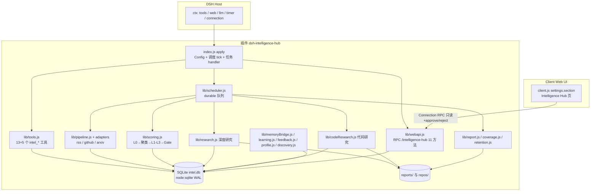
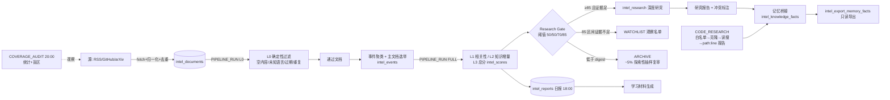
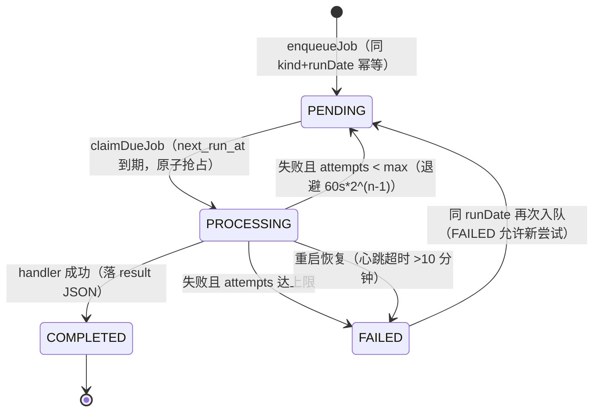

# 架构说明 — dsh-intelligence-hub

## 总体架构

插件分两半：

- **Host 半部**（`index.js` + `lib/`）：cordis Host 插件（`name: intelligence-hub`，inject `['tools','web','llm','timer']`）。启动时打开 SQLite（node:sqlite，WAL），恢复陈旧任务，注册 13+5 个工具，启动 60 秒调度 tick，并在 `connection` 服务可用时挂载只读 RPC 通道 `/intelligence-hub`。
- **Client 半部**（`client.js`）：Web 管理页，注册 `settings.section`（Intelligence Hub），全部数据经 `/intelligence-hub` RPC 通道取自 Host，渲染只用 textContent/白名单 markdown。

数据落盘：`~/.dsh/plugins-data/dsh-intelligence-hub/`（`intel.db`、`reports/`、`repos/`）。

## 数据流

## 数据库表清单（`lib/db.js`，均以 `intel_` 前缀 + `schema_version` 迁移表）

| 表名 | 用途 |
|---|---|
| intel_sources | 配置的信息源（rss/github/arxiv）及运行状态、质量调整 |
| intel_documents | 采集的文档全文/摘要、去重键、语言、主题 |
| intel_collection_jobs | 每次采集运行的统计（fetched/inserted/error） |
| intel_reports | 每日日报（report_date 唯一）与 Markdown 正文 |
| intel_job_executions | durable 任务队列（去重、重试、心跳、恢复） |
| intel_interest_profiles | 兴趣画像 JSON（confirm 才持久化的长期字段） |
| intel_events | 事件聚类结果与主文档选举 |
| intel_document_events | 文档—事件归属关系 |
| intel_knowledge_deltas | L2 知识增量记录 |
| intel_scores | L1/L2/L3 打分明细与总分（ranking_version） |
| intel_research_candidates | Research Gate 产生的研究候选 |
| intel_feedback | 用户反馈及质量调整轨迹（ranking_version v1） |
| intel_github_projects | GitHub watch 列表与最近分析 commit |
| intel_github_snapshots | GITHUB_SYNC 时的仓库快照（stars、head） |
| intel_research_tasks | 研究/代码研究任务状态与 checkpoint |
| intel_code_reports | 代码研究结构化报告（含证据） |
| intel_learning_materials | 生成的学习材料 |
| intel_coverage_reports | 覆盖审计结果摘要 |
| intel_source_candidates | 自动发现的源候选与 SSRF 安全结论 |
| intel_knowledge_facts | 版本化知识事实（记忆桥接，只读导出源） |
| schema_version | 数据库迁移版本 |

## 任务类型与状态机

任务类型（`lib/scheduler.js` `JOB_KINDS`）：DAILY_DISCOVERY、RSS_SYNC、GITHUB_SYNC、PAPER_SYNC、CONTENT_ANALYSIS、DAILY_REPORT、PIPELINE_RUN、CODE_RESEARCH、RESEARCH_TASK、COVERAGE_AUDIT。

去重：同 `kind + run_date` 存在 PENDING/PROCESSING/COMPLETED 行则拒绝重复入队（PIPELINE_RUN 的 run_date 为 `日期#槽位`；RESEARCH_TASK 为 `日期#task_id`；CODE_RESEARCH 为 `repo@commit`）。失败按指数退避重试至 maxAttempts（默认 3）；重启时心跳超时的 PROCESSING 行标记 FAILED 并重建 PENDING。

